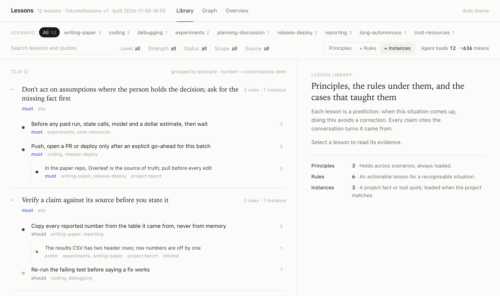
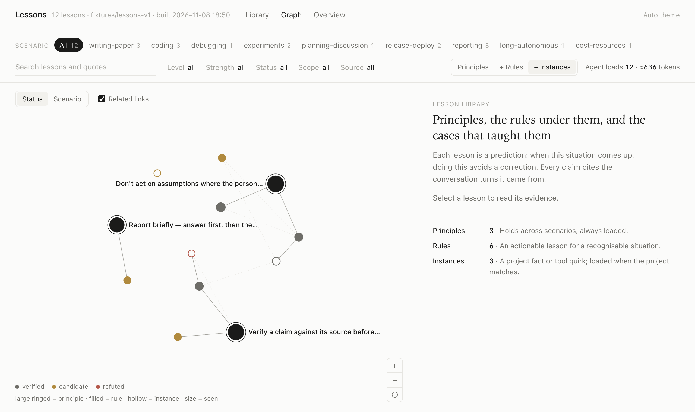
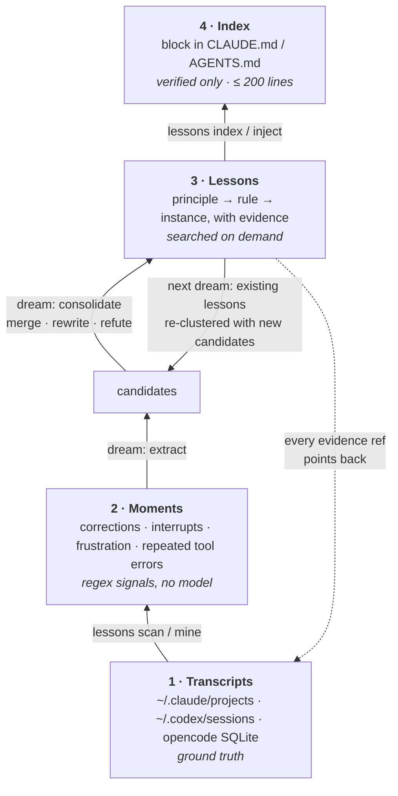

# Learn from Lessons

**A tool and agent skill that lets your coding agents learn from the corrections you already gave them.**

[](../LICENSE)
[](pyproject.toml)
[](#integrations)
[](#roadmap)



`lessons` reads the transcripts that Claude Code, Codex and opencode already keep on your disk. It finds the
moments where you corrected, stopped or redirected the agent, and turns them into short lessons. Each lesson
cites the transcript turns it came from, says whether it has held up in more than one conversation, and sits in a
hierarchy (**principle → rule → instance**) that can be filtered by scenario. Agents read the lessons through a
Claude Code skill, an `AGENTS.md` block, or an MCP server.

No dependencies beyond the Python ≥ 3.9 standard library. Your transcripts and lessons stay on your machine.

> **Status: prototype (v0.0.1).** The pipeline runs end to end on the author's machine. The evaluation has not
> been run yet ([Evaluation](#evaluation)), and flags and file formats may still change.

---

## Contents

[Quickstart](#30-second-quickstart) · [What a lesson looks like](#what-a-lesson-looks-like) · [Why](#why) ·
[How it works](#how-it-works) · [Integrations](#integrations) · [Parameters](#parameters) · [Commands](#commands) ·
[Privacy](#privacy) · [Evaluation](#evaluation) · [Roadmap](#roadmap) ·
[Call for collaboration](#call-for-collaboration) · [Citation](#citation)

## 30-second quickstart

```bash
uvx learn-from-lessons scan          # run once without installing
# or
pipx install learn-from-lessons      # installs the `lessons` command

lessons scan     # what is on this machine: sessions, human sessions, moments (counts only, no model)
lessons dream    # extract + consolidate lessons, using the agent CLI you already have as the model
lessons view     # browse lessons, their evidence and the graph in a local HTML page
```

> Until the first PyPI release, install from GitHub:
> `pipx install git+https://github.com/assassin808/learn-from-lessons`
> (or `uvx --from git+https://github.com/assassin808/learn-from-lessons lessons scan`).

`dream` calls whichever agent CLI is installed (`claude -p`, `codex exec` or `opencode run`), so it uses your
existing login and costs model calls. `lessons dream --dry-run` prints the prompts without calling anything, and
`--max-batches N` caps a run (default 10). For scale: on the author's machine one extract batch of about 20
moments cost about $0.09 with `claude -p`.

Then put the lessons in front of your agents:

```bash
lessons inject --target CLAUDE.md          # prints a diff; add --apply to write it
lessons search "deploy to vercel" --cwd    # what an agent runs before a risky task
```

| Lesson graph | Lesson list |
|---|---|
|  |  |

## What a lesson looks like

One Markdown file per lesson under `~/.lessons/lessons/<scope>/`. Full spec:
[docs/LESSON_FORMAT.md](LESSON_FORMAT.md) (v1). This example is **synthetic**: one principle, and one of
the rules that supports it.

```markdown
---
id: ask-before-irreversible
title: Ask before any step the person cannot undo
level: principle
parent:
scope: global
kind: workflow
scenarios: [any]
strength: must
trigger: an action that publishes, deletes, spends money or rewrites shared history
status: verified
seen: 4
themes: [consent, irreversible]
---

**Do:** Stop and ask for an explicit go-ahead before an irreversible step, even when it seems implied.

**Why:** Supported by its rules (push-only-after-go-ahead, ask-before-paid-run).
```

```markdown
---
id: push-only-after-go-ahead
title: Push or open a PR only after an explicit go-ahead for this batch
level: rule
parent: ask-before-irreversible
scope: global
kind: workflow
scenarios: [coding, release-deploy]
strength: must
trigger: about to run git push, gh pr create, or a deploy
status: verified
evidence:
  - ref: ~/.claude/projects/-Users-me-webapp/3f1c….jsonl:412
    source: claude-code
    date: 2026-09-14
    quote: "stop, I didn't say push yet"
  - ref: ~/.codex/sessions/2026/10/02/rollout-….jsonl:88
    source: codex
    date: 2026-10-02
    quote: "why did you open a PR, I wanted to review the diff first"
seen: 2
first_seen: 2026-09-14
last_seen: 2026-10-02
themes: [git, push, consent]
---

**Do:** Commit locally, show the diff, and wait for "push" before pushing or opening a PR.

**Why:** Twice the agent pushed work the person still wanted to review, and they had to stop it.

**Check:** You have a message from the person, after the last commit, that says to push.
```

| field | values |
|---|---|
| `level` | `principle` (few, always loaded) · `rule` (most lessons) · `instance` (a project fact or tool quirk) |
| `scope` | `global` · `project:<path>` (only shown inside that project) · `tool:<claude-code\|codex\|opencode>` |
| `kind` | `preference` · `workflow` · `pitfall` · `fact` · `communication` |
| `scenarios` | from a small fixed vocabulary in [docs/SCENARIOS.md](SCENARIOS.md): `coding`, `writing-paper`, `release-deploy`, … |
| `strength` | `must` (the person stopped or reverted the agent) · `should` · `prefer` |
| `status` | `candidate` → `verified` once seen in ≥ 2 distinct conversations (forks counted once) · `refuted` |

## Why

- **Agents start every session from zero, and every tool from zero.** Something you told Claude Code on Monday is
  unknown to Codex on Tuesday, and to Claude Code itself the next week.
- **Corrections tell you the most.** Usually the agent did what was asked. A correction, an interrupt, or the same
  tool failing three times marks the place where it did not, and the turns around it say why.
- **Hand-written `CLAUDE.md` rules drift.** They are written from memory, carry no evidence, and grow until nobody
  reads them. Here every lesson points back to the turns it came from and has to recur before it is injected.
- **The transcripts already exist.** Claude Code, Codex and opencode all write them to disk, so there is nothing
  new to record.

What one person's history yields (the author's machine, 2026-11-08):

| | |
|---|---|
| Claude Code sessions on disk | 19,770, of which ~130 were conversations with a person (the rest one-turn scripted runs) |
| Codex / opencode human sessions | 25 / 3 |
| moments, after removing forked/resumed duplicates | 1,052: 373 corrections, 424 interrupts, 203 frustration, 52 repeated tool failures |
| candidates → lessons | 161 hand-extracted candidates consolidated into 74 lessons, 54 verified |
| evidence quotes re-checked against transcripts | 484, of which 467 matched exactly |

## How it works

The design follows Anthropic's
[**The Components of Agent Memory**](https://www.anthropic.com/research/components-of-agent-memory). In that
framing transcripts are the ground truth, derived notes are predictions that need evidence, a consolidation pass
("dreaming") rewrites and checks those notes instead of appending to them, and the layer injected into every
session stays small. We took this structure from the article. Any mistakes in applying it are ours.



1. **Read.** Each tool's history is parsed into one shape, a `Session` holding a list of `Turn`s
   ([`lessons/sources/`](../lessons/sources/)). Subagents and one-turn scripted runs are skipped.
2. **Find moments, without a model** ([`lessons/signals.py`](../lessons/signals.py)). A moment is a user turn that
   opens with a correction (English and Chinese patterns), an interrupt, frustration, or a third failure in a
   row from the same tool. Turns copied into forked or resumed sessions count once.
3. **Dream, part 1: extract.** Moments and the turns before them are sent to the model in batches. It proposes
   lessons that cite refs. Evidence citing a ref that was not in the batch is thrown away, and so is a lesson
   left with none. Dates and `seen` are computed from the transcripts, never taken from the model.
4. **Dream, part 2: consolidate.** New candidates and existing lessons are clustered locally. The model merges,
   keeps apart or refutes each cluster. Evidence is only ever unioned, never deleted, and every change is
   written to `CHANGELOG.md`. Runs are incremental: sessions that have not changed are skipped.
5. **Serve.** A small index of verified lessons goes into every session. Everything else is reached through
   search (BM25, verified and same-project lessons ranked first).

More detail, including what is deliberately left out: [docs/HOW_IT_WORKS.md](HOW_IT_WORKS.md).

## Integrations

`lessons inject` only ever rewrites the text between `<!-- learn-from-lessons:start -->` and
`<!-- learn-from-lessons:end -->`. The rest of the file is left alone, and without `--apply` it only prints a diff.

**Claude Code**: the index, plus a skill that tells the agent when to search.

```bash
lessons inject --target ~/.claude/CLAUDE.md --apply      # or ./CLAUDE.md for one project
mkdir -p ~/.claude/skills/learn-from-lessons
cp skill/SKILL.md ~/.claude/skills/learn-from-lessons/
claude mcp add lessons -- lessons mcp                    # optional: search_lessons / get_lesson tools
```

**Codex / opencode**: paste [integrations/AGENTS.md](../integrations/AGENTS.md) into your `AGENTS.md`, then run
`lessons inject --target AGENTS.md --apply`. MCP is optional. For Codex, in `~/.codex/config.toml`:

```toml
[mcp_servers.lessons]
command = "lessons"
args = ["mcp"]
```

For opencode, in `opencode.json`:

```json
{ "mcp": { "lessons": { "type": "local", "command": ["lessons", "mcp"] } } }
```

**Claude Desktop, Cursor and other MCP clients**: `lessons mcp` is a stdio server (newline-delimited JSON-RPC
2.0, no SDK). Add it to `claude_desktop_config.json` or `.cursor/mcp.json`:

```json
{
  "mcpServers": {
    "lessons": { "command": "lessons", "args": ["mcp"] }
  }
}
```

| MCP tool | arguments | returns |
|---|---|---|
| `search_lessons` | `query`, `cwd?`, `k?` (default 8) | ranked ids, status, kind, scope, trigger |
| `get_lesson` | `id` | the full lesson file, evidence included |

## Parameters

How much reaches the agent is set by the lesson fields above and by these knobs.

| parameter | where | what it does | status |
|---|---|---|---|
| `k` | `lessons search -k`, MCP `k` | max results (default 8) | available |
| scope | `lessons search --cwd` / `--at DIR`, MCP `cwd` | drop other projects' lessons, rank this project's higher | available |
| verified-only | `lessons index` / `inject` | the injected index holds verified lessons only, ≤ 200 lines; when it overflows, the most-seen lessons are kept | available (always on for the index) |
| level (abstraction) | `--level principle\|rule\|instance` | how specific the injected layer may get: principles only, up to rules, or everything | specified in [LESSON_FORMAT.md](LESSON_FORMAT.md), flag in progress |
| scenario | `--scenario coding,release-deploy` | only lessons whose `scenarios` match (plus `any`) | in progress |
| strength | `--strength must\|should\|prefer` | minimum strength to include | in progress |
| verified-only for search | `--verified-only` | hide candidates from search results (today they rank below verified ones) | in progress |
| dream budget | `lessons dream --max-batches`, `--batch-tokens`, `--budget-usd`, `--engine`, `--model` | how much model work one run may do, and with which CLI | available |

Run `lessons <command> --help` for the flags your installed version supports.

## Commands

| command | what it does | model calls |
|---|---|---|
| `lessons scan` | sessions, human sessions, user turns and moments per source (counts only) | no |
| `lessons mine --out work/shards` | export moments as redacted JSONL shards, grouped by project | no |
| `lessons dream` | extract and consolidate lessons (`--dry-run`, `--max-batches`, `--engine`, …) | **yes** |
| `lessons index` | write `INDEX.md` in the lessons dir (verified, ≤ 200 lines) | no |
| `lessons inject --target FILE [--apply]` | put the index into `CLAUDE.md` / `AGENTS.md` between markers | no |
| `lessons search "<query>" [--cwd]` | BM25 over title, trigger, themes and body | no |
| `lessons view [--open]` | static HTML viewer for lessons, evidence and the graph | no |
| `lessons mcp` | stdio MCP server | no |

Lessons live in `~/.lessons` (override with `--dir` or `LESSONS_DIR`).

## Privacy

- **Local by default.** `scan`, `mine`, `index`, `inject`, `search`, `view` and `mcp` make no network calls.
- **`dream` is the one exception.** It sends redacted transcript excerpts to the agent CLI you already use, which is
  where those transcripts came from in the first place. `--dry-run` shows exactly what would be sent.
- **Redaction.** API keys (`sk-…`), GitHub, Slack and AWS tokens, JWTs, private keys and `password=`-style values
  are replaced before an excerpt is exported or written into a lesson ([lessons/redact.py](../lessons/redact.py)).
  Redaction is pattern-based and will miss things, so read lessons before you share them.
- **Excluded projects.** Sessions you must not send anywhere (client work, health or bank data) can be kept out of
  `scan`, `mine` and `dream` with `~/.lessons/exclude-projects` (or `LESSONS_EXCLUDE_FILE`), one line each:

  ```text
  # a plain path: that folder and everything below it
  ~/clients
  # a glob on the whole folder path, without case
  *medco*
  # session:<word> skips every session that mentions the word in any turn, tool output included
  session:patient
  # text:<word> drops only the moments whose turns (the ones sent to the model) mention it
  text:acme
  ```

  Folders are compared after symlinks are resolved, and a glob also matches the folders below it. Words are
  checked on everything a moment carries into a prompt: turns, tool names and the project folder. With any line
  set, a session whose folder is unknown is skipped too. `scan` prints how many sessions and moments the file
  kept out. A session with a dropped moment is read again on the next run, so removing a line takes effect.
  When a lesson already on disk matches the file, `dream` stops before any model call and names it: move or
  delete it first. Shards written by `mine` before a `session:` line was added hold only the moment's turns;
  run `mine` again after you change the file.
- **Nothing is uploaded.** There is no telemetry and no server. Lessons are plain Markdown files: delete
  `~/.lessons` and they are gone.

## Evaluation

We tested whether lessons change what an agent does in situations it has never seen: 47 new scenarios, each in a
different project from the conversations the lesson came from, with tools such as push, edit and paid runs.
Blind judges checked each response against the person's rule.

| notes given to the agent | follows the person's rule |
|---|---|
| none | 85% |
| all verified lessons (~9.4k tokens) | 98% |
| principles + the relevant lesson | 100% |

No scenario got worse with lessons, and lessons did not make the agent over-cautious in look-alike situations
where the rule should not fire. This is one person's data with simulated tools; we'd like to repeat it with more
people — see the call for collaboration. Code: `eval/`.

## Roadmap

- [ ] Publish to PyPI so `uvx learn-from-lessons` works directly
- [ ] `--level`, `--scenario`, `--strength`, `--verified-only` on `index`, `inject`, `search` and MCP
- [ ] Run the held-out evaluation above and publish the protocol and aggregate results
- [ ] Verification by outcome: a lesson holds when a later session meets its trigger without a correction
- [ ] Session-start hooks that run `lessons search` for the current project automatically
- [ ] More readers: Cursor, Aider, Gemini CLI, Cline
- [ ] Opt-in, reviewed lesson packs that teams can share

## Call for collaboration

This is an early research prototype, and it gets better with more people's histories and more agents.
We are looking for:

- **Tool builders: readers for more agents.** Cursor, Aider, Gemini CLI, Cline and others each store history in
  their own format. A reader is one file that yields `Session`/`Turn` objects; see
  [CONTRIBUTING.md](../CONTRIBUTING.md#adding-a-source-reader).
- **Users: anonymised lesson statistics.** Counts only, no text: moments per kind, lessons per level and kind,
  verified share, quote-match rate. These show whether the patterns hold beyond one person. Please never send
  transcripts or lesson text.
- **Researchers: co-authors for the evaluation.** We would like to design and run the held-out test with people
  who study agent memory, human–AI interaction or learning from feedback.

Get in touch through [GitHub Discussions](https://github.com/assassin808/learn-from-lessons/discussions)
for ideas and collaboration, or [Issues](https://github.com/assassin808/learn-from-lessons/issues) for bugs
and reader requests.

## Citation

If you use this tool or its lesson format, please cite the repository. The design is based on Anthropic's article,
which should be cited as well.

```bibtex
@software{learn_from_lessons_2026,
  author  = {{learn-from-lessons contributors}},
  title   = {Learn from Lessons: Turning Coding-Agent Corrections into Verified, Evidence-Linked Lessons},
  year    = {2026},
  url     = {https://github.com/assassin808/learn-from-lessons},
  version = {0.0.1},
  license = {MIT}
}

@misc{anthropic_agent_memory_2026,
  author       = {{Anthropic}},
  title        = {The Components of Agent Memory},
  year         = {2026},
  howpublished = {\url{https://www.anthropic.com/research/components-of-agent-memory}}
}
```

Machine-readable metadata: [CITATION.cff](../CITATION.cff).

## Acknowledgements

- Anthropic's [The Components of Agent Memory](https://www.anthropic.com/research/components-of-agent-memory),
  which gives the four layers, "lessons are predictions with evidence", and consolidation by dreaming.
- The Claude Code, Codex and opencode teams, for keeping transcripts as readable local files.
- The [Model Context Protocol](https://modelcontextprotocol.io), which lets one server work across clients.
- Developed within [HumanStudy-Hub](https://github.com/HumanStudy-Hub).

## License

[MIT](../LICENSE) © 2026 learn-from-lessons contributors
