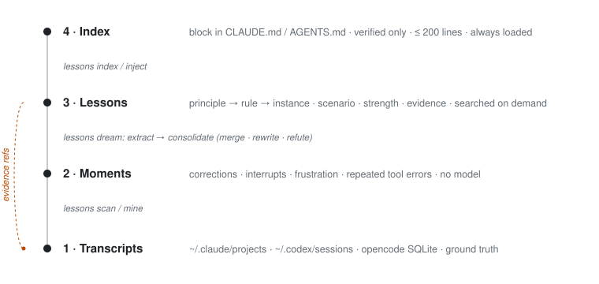

# How it works

This page explains the design and the reasons behind it. For the file format see
[LESSON_FORMAT.md](LESSON_FORMAT.md). For the scenario vocabulary see [SCENARIOS.md](SCENARIOS.md).

## Where the design comes from

The structure follows Anthropic's
[The Components of Agent Memory](https://www.anthropic.com/research/components-of-agent-memory). We took four
ideas from it:

| idea from the article | what it means here |
|---|---|
| Raw transcripts are the ground truth | Lessons never replace transcripts. Every rule and instance cites `path:line` or `db#message` refs. |
| Derived memory is a prediction | A lesson says "in this situation, doing X avoids a correction". It starts as `candidate`, becomes `verified` when it recurs, and can be `refuted`. |
| Consolidate ("dream"), don't append | `lessons dream` re-clusters old and new lessons and rewrites them. It does not add a note per incident. |
| Keep the always-loaded layer small | Only verified lessons are injected, at most 200 lines. The rest is reached by search. |

How we applied these ideas, and any mistakes in doing so, are our responsibility.

## Layer 1: transcripts

Readers in `lessons/sources/` parse each tool's history into one model (`lessons/model.py`): a `Session` holds
a list of `Turn`s with `role`, `text`, `ts`, `tool`, `error` and `ref`.

| source | where | format |
|---|---|---|
| Claude Code | `~/.claude/projects/<project>/<session>.jsonl` | JSONL; subagents are `agent-*.jsonl` or `isSidechain` |
| Codex | `~/.codex/sessions/**/*.jsonl` | JSONL with `session_meta` / `response_item` records |
| opencode | `~/.local/share/opencode/opencode.db` (and app-embedded copies) | SQLite `session` / `message` / `part`, opened read-only |

Text the harness writes into the user role (system reminders, command output, "this session is being continued"
summaries) is filtered out, so only words the person typed count as user turns.

**Which sessions count.** A session is *human* when it is not a subagent and has at least 3 user turns.
`dream` also skips one-turn scripted runs (`claude -p` and the like), including its own prompts. Most sessions
on a heavy user's machine are scripted: on the author's machine, about 130 of 19,770 Claude Code sessions were
conversations with a person.

## Layer 2: moments

`lessons/signals.py` finds moments with regular expressions. It uses no model, so `scan` is free and private.

| kind | what triggers it |
|---|---|
| `correction` | a user turn that *opens* with pushback: "no", "wrong", "I said", "why did you", "don't", "revert", … and the Chinese equivalents (不是, 不对, 别, 我说, …) |
| `interrupt` | `[Request interrupted by user…]`; the reason is usually in the next user turn, which is kept as `followup` |
| `frustration` | "you keep", "again", "说了多少次", … within the first 400 characters |
| `repeated-error` | the same session's tool results fail three times in a row |

A moment only counts after the agent has spoken, because a correction answers something the agent did. Each
moment keeps up to 6 turns before it (8 for repeated errors) and up to 2 turns after it. Resumed and forked
sessions copy earlier turns under a new id, so a turn already seen in another session is counted once.

The patterns favour precision at the start of a turn over recall. Many interrupts and corrections teach nothing
lasting, and the extract step is told to skip them.

## Layer 3: lessons, and the dream loop

`lessons dream` has two passes. Both are incremental: `~/.lessons/state.json` records hashes of moments already
processed and of sessions that have not changed, never their text.

**Extract.** New moments are rendered with short refs (`[r12]`) and packed into prompts of about 12k tokens
(`--batch-tokens`; one batch held about 20 moments on the author's data, costing about $0.09 with `claude -p`).
The prompt is [`lessons/prompts/extract.md`](../lessons/prompts/extract.md). The model answers with JSON
lessons. Then the code, not the model, decides what to keep:

- evidence citing a ref that is not in the batch is thrown away, and a lesson left with no evidence is dropped
- a quote that does not appear in the cited turn is replaced by that turn's own (redacted) words
- `date`, `first_seen`, `last_seen` and `seen` are computed from the cited turns
- `seen` counts distinct sessions. Turns copied into forked or resumed sessions were already removed at the
  moment stage, so a fork does not add a second sighting
- `status` is `verified` when `seen >= 2`, otherwise `candidate`

**Consolidate.** Candidates and existing lessons are clustered locally by word and theme overlap (leader
clustering, `--threshold 0.3`, at most 8 per cluster). Only clusters that contain something new go to the
model ([`lessons/prompts/consolidate.md`](../lessons/prompts/consolidate.md)), which may merge lessons, keep
them apart, or mark one `refuted` with the contradicting evidence. The model never handles evidence: a merged
lesson keeps the union of its members' evidence, and nothing is deleted. Every change is written to
`CHANGELOG.md` in the lessons directory.

**The model is your own agent CLI** (`--engine auto|claude|codex|opencode`). No API key is needed. `--engine
fake` gives deterministic answers for tests, and `--dry-run` prints the batches and prompts without calling
anything.

### The hierarchy

v1 lessons sit at one of three levels: `principle` (a few general tenets with no evidence of their own,
supported by ≥ 2 rules), `rule` (most lessons), and `instance` (a project fact or tool quirk, with a rule as its
parent). Each lesson also lists `scenarios` from a small vocabulary and has a `strength` (`must` / `should` /
`prefer`). This lets an agent load principles always, rules for the current scenario, and instances only in the
matching project.

> **What is automated today.** The 74-lesson library on the author's machine (54 verified) was consolidated from
> 161 **hand-extracted** candidates, and the hierarchy was assigned in that consolidation. The automatic extract
> prompt currently emits flat lessons (`scope`, `kind`, `trigger`, evidence). Automatic assignment of levels,
> scenarios and strength, and the matching `--level` / `--scenario` / `--strength` filters, are in progress.

**Checking evidence.** Quotes are meant to be the person's exact words. In a re-check of 484 evidence quotes
against the transcripts, 467 matched exactly; the other 17 did not and need a manual look.

## Layer 4: the index

`lessons index` writes `INDEX.md`. `lessons inject --target FILE` puts the same text between
`<!-- learn-from-lessons:start -->` and `<!-- learn-from-lessons:end -->` in `CLAUDE.md` or `AGENTS.md`. It
prints a diff unless `--apply` is given.

- verified lessons only, one line each (title and trigger), grouped by scope and kind
- project lessons appear only when the target file sits inside that project
- at most 200 lines; when over budget, the lessons seen in the most conversations stay and a note points to search

Everything else is served on demand. `lessons search` (and the MCP tool `search_lessons`) ranks lessons with
BM25 over title, trigger, themes and body, multiplies the score by 1.5 for verified lessons and by 1.3 for
lessons from the same project, and drops other projects' lessons and refuted ones. The skill
([`skill/SKILL.md`](../skill/SKILL.md)) and the `AGENTS.md` block
([`integrations/AGENTS.md`](../integrations/AGENTS.md)) tell the agent *when* to search: before risky,
irreversible or recurring work, when entering a project, and right after a correction.

## What is deliberately not here

- **No embeddings, no vector store.** Lessons are short and few, and BM25 plus scope works without a model or a
  network connection.
- **No automatic writes into your config.** `inject` shows a diff first, and agents are told not to edit lesson
  files from inside a task.
- **No server.** Lessons are Markdown files you can read, edit, grep and delete.
- **No claim of effectiveness yet.** See [Evaluation in the README](../README.md#evaluation).
